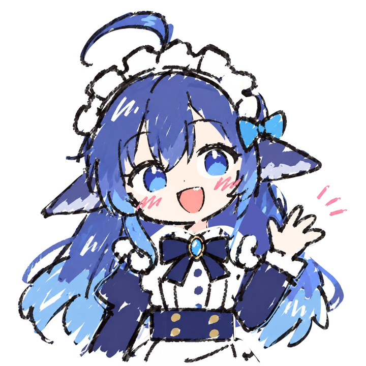
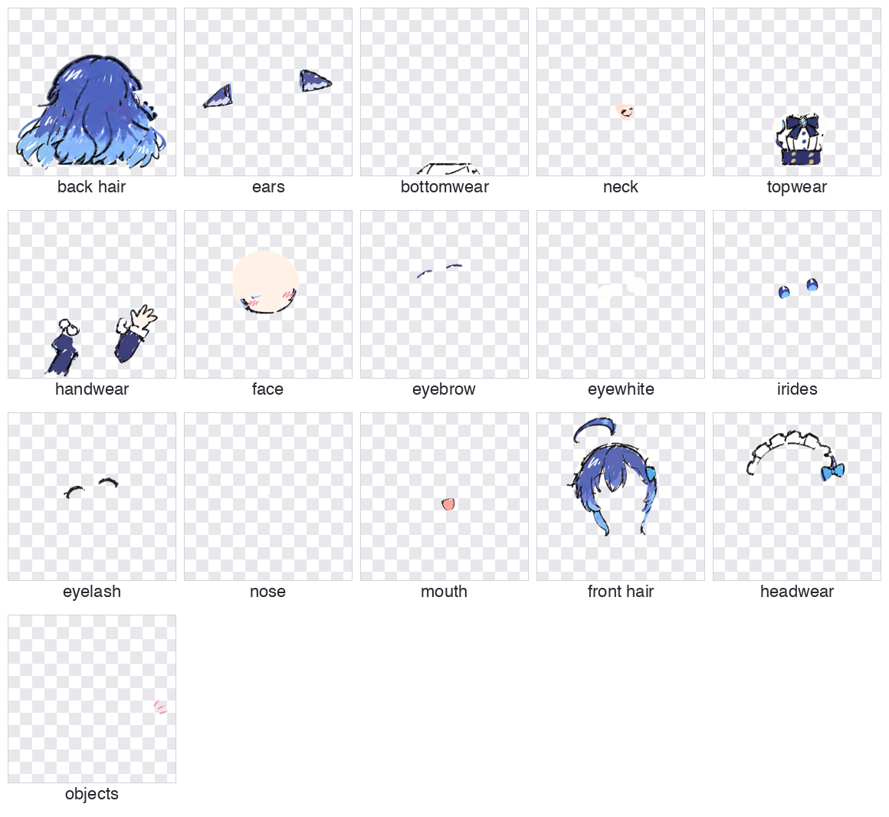
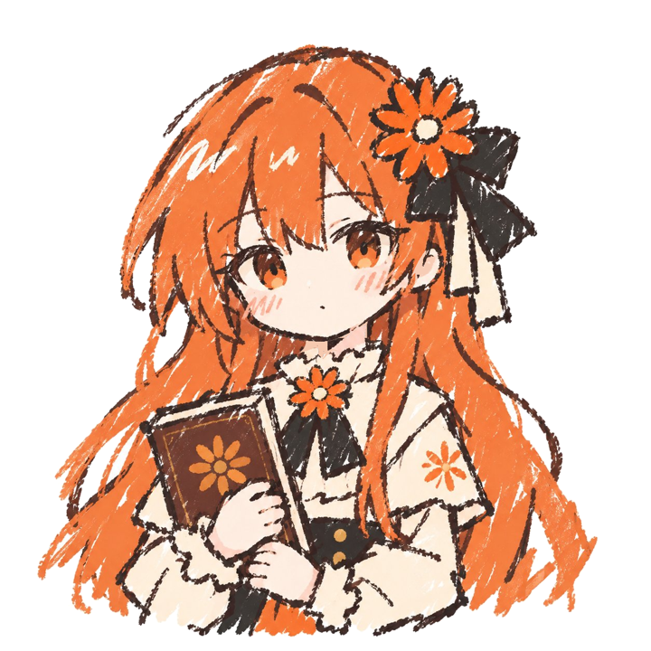
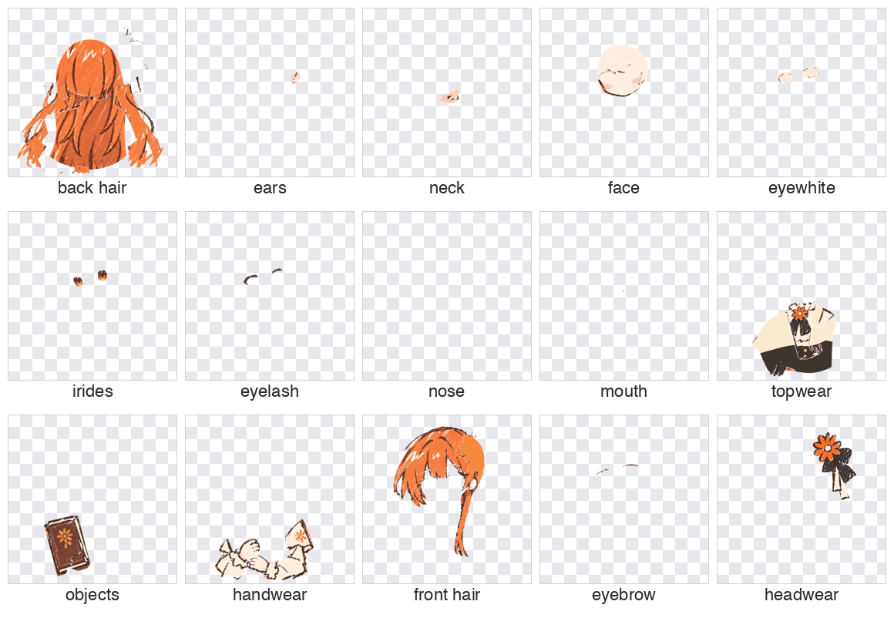
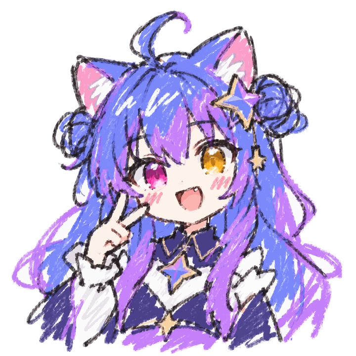
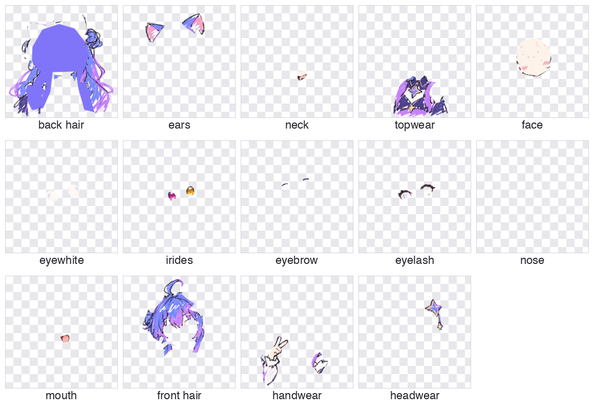

# image-to-psd

**English** | [中文](README.zh-CN.md)

An agent skill that turns a single character illustration (PNG / JPG / SVG) into a **layered PSD** ready for 2.5D animation: 19 standard parts, each with its own pixels and an editable mask.

| Original | Extracted layers |
|---|---|
|  |  |

## Install

```bash
npx skills add link-ding/image-to-psd --skill image-to-psd -a codex -g -y
```

- `-a codex`: install for Codex. Use another agent name to install elsewhere.
- `-g`: install globally, available in every project.
- `-y`: skip the confirmation prompts.

The export script needs these Python packages:

```bash
pip install pillow numpy psd-tools
```

Add `cairosvg` if you want to read SVG input.

## Usage

Give the agent a character image and say:

```
Use $image-to-psd to split this character artwork into a layered PSD
```

The skill's instructions are written in Chinese; the agent follows them whatever language you prompt in. It will:

1. Study the artwork and work out each part's boundaries and occlusion.
2. Generate part reference images with ImageGen.
3. Segment the visible areas from the original, and fill in what is hidden (the face under the bangs, the back hair behind the head, the eye whites under the irises).
4. Export a PSD where every layer has its own RGBA pixels and a grayscale mask.
5. Reopen the PSD and review it layer by layer, fixing bleed between layers, gaps and stray fragments before delivery.

Art style, colors, pose, position and canvas size stay unchanged.

## The 19 standard layers

| Layer | Contents |
|---|---|
| `back hair` | Hair behind the head |
| `front hair` | Bangs and side locks |
| `face` | Continuous face base, blush |
| `ears` | Human or animal ears |
| `earwear` | Earrings |
| `eyebrow` | Both eyebrows |
| `eyewhite` | Both eye whites |
| `irides` | Irises, pupils, highlights |
| `eyelash` | Eyelashes, eyeliner |
| `nose` | Nose |
| `mouth` | The mouth as drawn |
| `headwear` | Hair accessories, hats, head bows |
| `neck` | Neck |
| `topwear` | Top and its decorations |
| `handwear` | Hands, arms, sleeves, gloves |
| `bottomwear` | Skirt, trousers |
| `legwear` | Legs, socks |
| `footwear` | Shoes |
| `objects` | Hand-held props |

Parts that are not in the artwork are kept as empty layers. When a hand and a prop overlap in both directions, `handwear` can be split into `handwear back` and `handwear front`, giving 20 layers.

## Examples

[`examples/`](examples) holds PSDs made with this skill. Download them and open in Photoshop, Krita or Clip Studio Paint.

### Blue Maid

 

[Download blue_maid.psd](examples/blue_maid.psd) (1254×1254, 12 MB)

### Orange Book Girl

 

[Download orange_book_girl.psd](examples/orange_book_girl.psd) (1254×1254, 12 MB)

### Star Cat

 

[Download star_cat.psd](examples/star_cat.psd) (1254×1254, 10 MB)

## Using the export script on its own

If you already have transparent part PNGs or a layered SVG, you can skip the agent and export the PSD directly:

```bash
python skills/image-to-psd/scripts/layered_assets.py psd-png parts.json character.psd --report qa.json
```

```bash
python skills/image-to-psd/scripts/layered_assets.py psd existing.svg character.psd --report qa.json
```

`parts.json` lists the layers from back to front. Every PNG has the same size and position as the canvas:

```json
{"width":1254,"height":1254,"layers":[
  {"name":"back hair","png":"parts/back_hair.png"},
  {"name":"face","png":"parts/face.png"},
  {"name":"front hair","png":"parts/front_hair.png"}
]}
```

Standard layers you leave out are added as empty layers.

## Notes

- The skill provides a layer-splitting workflow and a reliable PSD export. It does not promise one-click, production-grade rigging quality for any artwork.
- Hidden areas are inferred. The agent tells you which parts were filled in when it delivers the file.
- Part reference images depend on an image generation tool (ImageGen in Codex).

## Repository layout

```
skills/image-to-psd/
├── SKILL.md              Workflow
├── references/           Layer spec, review checklist, transparency and compatibility notes
├── scripts/              PSD export script
└── agents/openai.yaml    Codex interface config
examples/                 Example PSDs and previews
```
