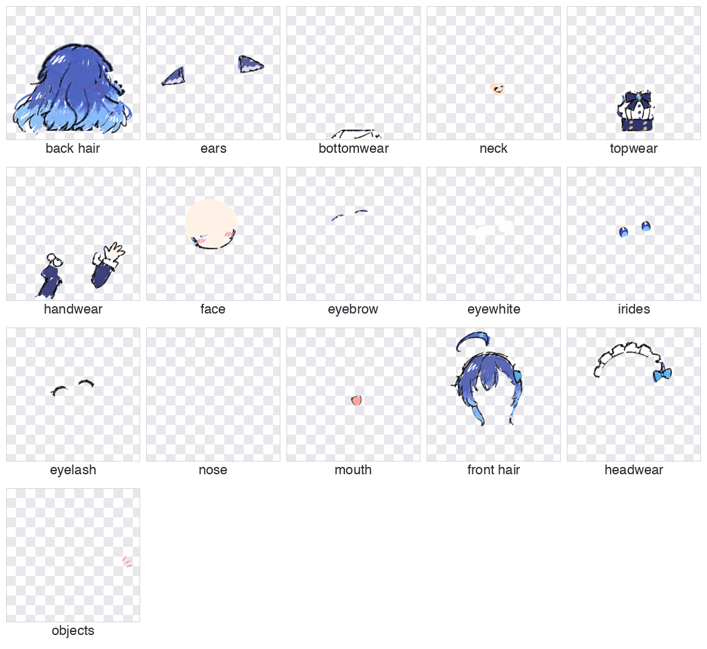
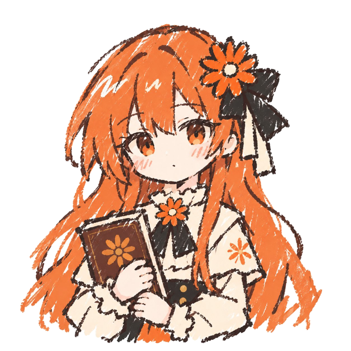
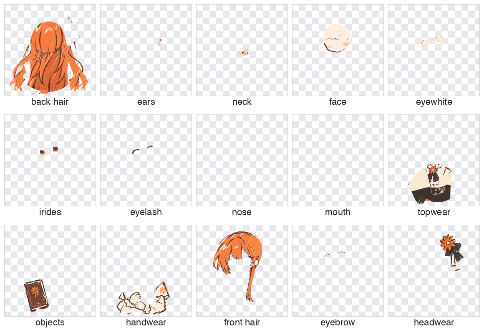
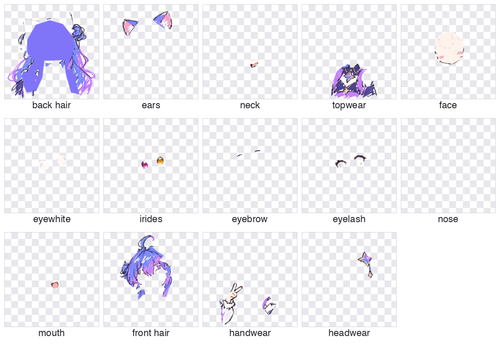

# image-to-psd

[English](README.md) | **中文**

把一张角色原画（PNG / JPG / SVG）拆成可直接用于 2.5D 动画的**分层 PSD**：19 个标准部件，每层带独立像素和可编辑蒙版。

| 原画 | 拆出的图层 |
|---|---|
|  |  |

## 安装

```bash
npx skills add link-ding/image-to-psd --skill image-to-psd -a codex -g -y
```

- `-a codex`：安装到 Codex。换成其他 agent 名称即可安装到别处。
- `-g`：全局安装，所有项目可用。
- `-y`：跳过确认。

导出脚本需要 Python 依赖：

```bash
pip install pillow numpy psd-tools
```

需要读取 SVG 输入时再装 `cairosvg`。

## 使用

把角色图发给 agent，然后说：

```
用 $image-to-psd 把这张角色图拆成分层 PSD
```

skill 会依次完成：

1. 查看原画，判断各部件的边界和遮挡关系。
2. 用 ImageGen 生成部件参考图。
3. 从原画分割可见部分，被遮住的地方（刘海下的脸、头后面的后发、瞳孔下的眼白）做补形。
4. 导出 PSD，每层带独立的 RGBA 像素和灰度蒙版。
5. 重新读取 PSD 逐层自查，修正串层、缺口和碎片后再交付。

画风、颜色、姿势、位置和画布大小都保持不变。

## 19 个标准图层

| 图层 | 内容 |
|---|---|
| `back hair` | 后发 |
| `front hair` | 前发、刘海、侧发 |
| `face` | 连续的脸部底形、腮红 |
| `ears` | 人耳或兽耳 |
| `earwear` | 耳饰 |
| `eyebrow` | 左右眉毛 |
| `eyewhite` | 左右眼白 |
| `irides` | 虹膜、瞳孔、高光 |
| `eyelash` | 睫毛、眼线 |
| `nose` | 鼻子 |
| `mouth` | 原画嘴型 |
| `headwear` | 发饰、帽子、头部蝴蝶结 |
| `neck` | 脖子 |
| `topwear` | 上衣及其装饰 |
| `handwear` | 手、手臂、袖子、手套 |
| `bottomwear` | 裙子、裤子 |
| `legwear` | 腿、袜子 |
| `footwear` | 鞋 |
| `objects` | 手持道具 |

原画里没有的部件保留为空层。手和道具前后交错时，可以把 `handwear` 拆成 `handwear back` 和 `handwear front`，共 20 层。

## 示例

[`examples/`](examples) 里是用这个 skill 做出来的 PSD，可以直接下载，用 Photoshop、Krita 或 Clip Studio Paint 打开。

### Blue Maid

 

[下载 blue_maid.psd](examples/blue_maid.psd)（1254×1254，12 MB）

### Orange Book Girl

 

[下载 orange_book_girl.psd](examples/orange_book_girl.psd)（1254×1254，12 MB）

### Star Cat

 

[下载 star_cat.psd](examples/star_cat.psd)（1254×1254，10 MB）

## 单独使用导出脚本

已经有拆好的透明 PNG 或分层 SVG 时，可以跳过 agent，直接导出 PSD：

```bash
python skills/image-to-psd/scripts/layered_assets.py psd-png parts.json character.psd --report qa.json
```

```bash
python skills/image-to-psd/scripts/layered_assets.py psd existing.svg character.psd --report qa.json
```

`parts.json` 按从后到前列出图层，每张 PNG 与画布同尺寸、同位置：

```json
{"width":1254,"height":1254,"layers":[
  {"name":"back hair","png":"parts/back_hair.png"},
  {"name":"face","png":"parts/face.png"},
  {"name":"front hair","png":"parts/front_hair.png"}
]}
```

没列出的标准图层会自动补成空层。

## 注意

- 这个 skill 提供的是拆层流程和可靠的 PSD 导出，不保证任意原画一键拆到生产级绑定质量。
- 被遮挡的部分是推补出来的，交付时 agent 会说明哪些部位是补画的。
- 部件参考图依赖图像生成工具（Codex 的 ImageGen）。

## 目录结构

```
skills/image-to-psd/
├── SKILL.md              工作流
├── references/           部件规范、审核清单、透明度与兼容性说明
├── scripts/              PSD 导出脚本
└── agents/openai.yaml    Codex 界面配置
examples/                 示例 PSD 与预览图
```
